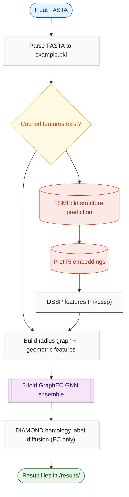

# Repository Analysis

| | |
|---|---|
| Repository | https://github.com/biomed-AI/GraphEC |
| Run ID | `20261009-120613-graphec-repo_analyst` |
| Generated | 2026-10-09 12:11 UTC |

## ⚠️ Read this first

**Verified by direct file inspection — these are facts, not judgement:**

> **🛑 ANALYSIS INCOMPLETE: GPU required but no VRAM estimate - the instance cannot be sized**
>
> **🛑 CONTRADICTS SCAN: analysis says code licence 'apache-2.0' but LICENSE reads as 'Apache License' - the file wins**

**Reported by the analyst:**

> **🛑 BLOCKER: EC prediction on novel sequences is broken out of the box** — EC_number/utils.py reads active sites from Active_sites/results/EC_test_ver1.pkl, which only covers bundled example IDs; the ActiveSite pre-step in main.py is commented out. New sequences need manual active-site prediction and pkl construction.
>
> **🛑 BLOCKER: Hardcoded ProtT5 model path** — Features/features.py line 39: /home/songyd/software/Prot-T5-XL-U50 must be edited to your local ProtT5-XL-U50 download.
>
> **🛑 BLOCKER: GPU effectively required** — torch.cuda.set_device(args.gpu) and model.cuda() are called unconditionally; CPU-only runs crash without code edits.
>
> **⚠️ WARNING: Weights licence unstated** — Code is Apache-2.0 but no licence accompanies the bundled checkpoints; commercial use unclear.
>
> **⚠️ WARNING: No dependency manifest** — No requirements.txt/setup.py; README lists exact versions (python 3.8.16, torch 1.13.1, pyg 2.3.0) which must be installed manually.
>
> **⚠️ WARNING: DIAMOND binary permissions** — README notes chmod -R 755 ./EC_number/tools/ may be needed.
>
> **ℹ️ INFO: Project appears unmaintained** — Last commit 2025-08-13; citation still 'preparing'; no tests or CI.

## What this is
GraphEC builds residue graphs (10 Angstrom Ca radius) from ESMFold-predicted structures with geometric node/edge features plus ProtT5 sequence embeddings and DSSP features. Active sites are predicted first and guide EC number prediction; a DIAMOND-homology label diffusion step refines EC predictions over 5106 labels. A separate head predicts optimum pH (acidic/neutral/alkaline). Each task is a 5-fold ensemble.

## Quickstart

**1. Install**
```bash
git clone https://github.com/biomed-AI/GraphEC.git && cd GraphEC
conda create -n graphec python=3.8 && conda activate graphec
pip install torch==1.13.1 torch_geometric==2.3.0 biopython==1.81 transformers scipy scikit-learn tqdm fair-esm openfold==1.0.1
chmod -R 755 ./EC_number/tools/
```

**2. Get the weights**
```bash
GraphEC fold checkpoints are bundled in the repo
Download ProtT5-XL-U50 from https://zenodo.org/record/4644188 and edit model_path in Features/features.py (line 39)
ESMFold weights auto-download on first run
```

**3. Run it**
```bash
bash run.sh EC_number ./Data/fasta/EC_number.fasta 0
```

Example input: `./Data/fasta/EC_number.fasta`

Expected result: EC_number/results/example_top5.txt with top-5 EC numbers and scores per sequence; example_all.txt with all 5106 scores

Roughly minutes for the bundled example (features precomputed); much longer for new sequences due to ESMFold.

**Watch out for:**
- Bundled example feature tensors let the EC example skip ESMFold/ProtT5, but only for the exact bundled IDs
- EC prediction on new sequences requires active sites; the pipeline step is commented out in main.py and EC_test_ver1.pkl only covers example IDs
- Hardcoded ProtT5 path must be edited
- GPU required; no CPU fallback without code edits

## Metadata
| | |
|---|---|
| **Model** | GraphEC |
| **Status** | unknown (last commit 1.2 years ago) |
| **Owner** | biomed-AI (Yidong Song, Sun Yat-sen University) |
| **Category** | protein function prediction |
| **Purpose** | Predict enzyme EC numbers, active sites, and optimum pH from protein sequences using geometric graph learning on ESMFold structures. |
| **Details** | GraphEC builds residue graphs (10 Angstrom Ca radius) from ESMFold-predicted structures with geometric node/edge features plus ProtT5 sequence embeddings and DSSP features. Active sites are predicted first and guide EC number prediction; a DIAMOND-homology label diffusion step refines EC predictions over 5106 labels. A separate head predicts optimum pH (acidic/neutral/alkaline). Each task is a 5-fold ensemble. |
| **Model size** | GraphEC checkpoints ~565 MB total (EC: 5x92.6 MB, AS: 5x6.1 MB, pH: 5x6.8 MB); plus external ESMFold ~2.5 GB and ProtT5-XL ~11 GB |
| **Peak memory** | - |
| **Compute** | GPU required |
| **Input** | fasta, int |
| **Output** | txt, txt, txt, txt |
| **Publication** | none stated (README: 'Citation: preparing') |
| **Paper / preprint** | - |
| **GitHub** | <https://github.com/biomed-AI/GraphEC>, <https://github.com/facebookresearch/esm>, <https://github.com/agemagician/ProtTrans>, <https://github.com/YidongSong/GraphEC> |
| **HuggingFace** | - |
| **Colab / demo** | - |
| **Code licence** | Apache-2.0 |
| **Weights licence** | not stated |
| **Commercial use** | unclear |
| **Last commit** | 2025-08-13 1413229 Update data.py |

## What it can do
| Task | Entrypoint | Inputs | Outputs | Supported | Notes |
|---|---|---|---|---|---|
| EC number prediction | `EC_number/main.py (via main.py --task EC_number)` | multi-entry FASTA | EC_number/results/example_top5.txt, example_all.txt | partial | works for bundled example IDs; novel sequences need active-site pkl that the pipeline does not generate (step commented out) |
| active site prediction | `Active_sites/main.py (via main.py --task ActiveSite)` | multi-entry FASTA | Active_sites/results/<ID>.txt per-residue scores | yes |  |
| optimum pH prediction | `Optimum_pH/main.py (via main.py --task Optimum_pH)` | multi-entry FASTA | Optimum_pH/results/<ID>.txt (acidic/neutral/alkaline) | yes |  |
| protein structure prediction (ESMFold) | `Features/esmfold/esmfold.py` | FASTA | PDB files | needs_extra_assets | downloads ESMFold weights on first run |

## Process flow


## Repository structure
```
./  (4 files)
  Active_sites/  (4 files)
    Active_sites/data/  (1 files)
    Active_sites/model/  (5 files)
    Active_sites/results/  (12 files)
  Data/  (1 files)
    Data/DSSP/  (30 files)
    Data/ProtTrans/  (32 files)
    Data/Structures/  (60 files)
    Data/fasta/  (3 files)
  EC_number/  (5 files)
    EC_number/data/  (5 files)
    EC_number/model/  (5 files)
    EC_number/results/  (2 files)
    EC_number/tools/  (1 files)
  Features/  (1 files)
    Features/dssp-2.0.4/  (1 files)
    Features/esmfold/  (3 files)
  Optimum_pH/  (4 files)
    Optimum_pH/data/  (1 files)
    Optimum_pH/model/  (5 files)
    Optimum_pH/results/  (10 files)
```

## Inputs
| Name | Format | Required | Description | Constraints | Example |
|---|---|---|---|---|---|
| `fasta` | fasta | yes | multi-entry protein FASTA; IDs used as file keys | single chain per entry; U/Z/O/B mapped to X; feature caching keyed by ID | `./Data/fasta/EC_number.fasta` |
| `gpu` | int | yes | GPU index; torch.cuda.set_device called unconditionally | - | `0` |

## Outputs
| Name | Format | Description | Constraints | Example |
|---|---|---|---|---|
| `ec_top5` | txt | top-5 EC numbers with scores per sequence | - | `EC_number/results/example_top5.txt` |
| `ec_all` | txt | scores for all 5106 EC labels per sequence | - | `EC_number/results/example_all.txt` |
| `active_sites` | txt | per-residue Num/AA/Score table per protein | - | `Active_sites/results/1BVZA.txt` |
| `optimum_pH` | txt | acidic/neutral/alkaline label per protein | - | `Optimum_pH/results/O14773.txt` |

## Inference entrypoint
| | |
|---|---|
| File | `main.py` |
| Function/class | `__main__ (dispatches to EC_number/main.py, Active_sites/main.py, Optimum_pH/main.py)` |
| How to call | bash run.sh EC_number ./Data/fasta/EC_number.fasta 0 |
| Input format | multi-entry FASTA |
| Output format | plain-text result files under <Task>/results/ |

## Scripts
| Path | Kind | Purpose | Invocation |
|---|---|---|---|
| `run.sh` | shell | main entry wrapper | `bash run.sh EC_number ./Data/fasta/EC_number.fasta 0` |
| `main.py` | cli | orchestrator | `python main.py --task EC_number --fasta ./Data/fasta/EC_number.fasta --gpu 0` |
| `EC_number/main.py` | cli | EC inference | `python ./EC_number/main.py --fasta X --gpu 0` |
| `Active_sites/main.py` | cli | active-site inference | `python ./Active_sites/main.py --gpu 0` |
| `Optimum_pH/main.py` | cli | pH inference | `python ./Optimum_pH/main.py --gpu 0` |
| `Features/esmfold/esmfold.py` | cli | ESMFold structure prediction | `python ./Features/esmfold/esmfold.py -i in.fasta -o out_dir --chunk-size 128` |

## Assets
| Path | Kind | Size (MB) | Availability | Description |
|---|---|---|---|---|
| `EC_number/model/` | weights | 463.0 | in repo | 5-fold EC checkpoints |
| `Active_sites/model/` | weights | 30.0 | in repo | 5-fold active-site checkpoints |
| `Optimum_pH/model/` | weights | 33.0 | in repo | 5-fold pH checkpoints |
| `EC_number/tools/diamond` | other | 40.0 | in repo | DIAMOND alignment binary |
| `Features/dssp-2.0.4/mkdssp` | other | - | in repo | DSSP binary |
| `EC_number/data/EC_train.fa` | data | 29.0 | in repo | training sequences for label diffusion |
| `Data/fasta/` | example | - | in repo | example FASTAs for all three tasks |
| `Data/Structures, Data/ProtTrans, Data/DSSP` | data | - | in repo | precomputed feature tensors for example IDs |
| `ProtT5-XL-U50` | weights | - | download | ProtTrans model, must be downloaded (Zenodo 4644188); hardcoded path in Features/features.py |
| `ESMFold v1 weights` | weights | - | download | auto-downloaded by fair-esm on first run |

## Compute requirements
| | |
|---|---|
| GPU required | True |
| Runs on CPU | False |
| Min GPU memory | - GB |
| Peak memory | - |
| Min RAM | - GB |
| Disk | 15.0 GB |
| Typical runtime | not stated; ESMFold folding is the bottleneck for new sequences |
| Notes | torch.cuda.set_device(args.gpu) called unconditionally in all task mains; get_prottrans calls model.cuda() unconditionally, so CPU-only runs crash without code edits. |

## Weights
- Source: bundled in repo (5-fold checkpoints per task); ESMFold and ProtT5 downloaded separately
- Location/ID: `EC_number/model/fold0-4.ckpt, Active_sites/model/fold0-4.ckpt, Optimum_pH/model/fold0-4.ckpt`
- Size: 0.57 GB
- Download: GraphEC folds are in the repo. ESMFold weights auto-download via esm.pretrained.esmfold_v1(). ProtT5-XL-U50 must be downloaded (Zenodo record 4644188) and the hardcoded path in Features/features.py line 39 edited.

## Licensing
| | |
|---|---|
| Code | Apache-2.0 (LICENSE) |
| Weights | not stated (no weights licence file found in repo) |
| Commercial use | unclear |
| Attribution required | False |
| Notes | Code is Apache-2.0; bundled checkpoint terms unstated. External ESMFold and ProtT5 weights have their own licences. |

## Tests
- Framework: none
- Paths: 
- Command: ``
- Approx. count: 0
- Needs GPU: False / needs weights: False

## Key files
| Path | Role |
|---|---|
| `main.py` | top-level orchestrator: FASTA parsing, feature extraction, task dispatch |
| `run.sh` | thin wrapper: python main.py --task $1 --fasta $2 --gpu $3 |
| `Features/features.py` | feature extraction: ESMFold coords, ProtT5 embeddings, DSSP |
| `EC_number/utils.py` | EC inference: 5-fold ensemble predict + label diffusion + result writing |
| `EC_number/label_diffusion.py` | homology graph via DIAMOND and label diffusion |
| `Active_sites/utils.py` | active-site per-residue inference |
| `Optimum_pH/utils.py` | optimum pH inference |

## Functions and classes
| File | Name | Signature | Purpose |
|---|---|---|---|
| `main.py` | `process_fasta` | `process_fasta(fasta_path)` | parse FASTA to dict, pickle to ./Data/example.pkl |
| `main.py` | `extract_features` | `extract_features(name_seq, fasta, gpu)` | compute missing ESMFold/ProtTrans/DSSP feature tensors |
| `Features/features.py` | `get_prottrans` | `get_prottrans(fasta_file, output_path, gpu)` | ProtT5-XL per-residue embeddings (hardcoded model path) |
| `Features/features.py` | `get_esmfold` | `get_esmfold(fasta_file, output_path)` | run ESMFold, extract N/CA/C/O/R coords to .tensor |
| `Features/features.py` | `get_dssp` | `get_dssp(fasta, dssp_path, esmfold_path, dssp_save)` | mkdssp secondary structure + ASA features |
| `EC_number/utils.py` | `predict` | `predict(args, seed)` | EC number ensemble inference + label diffusion |
| `EC_number/label_diffusion.py` | `LabelDiffusion` | `LabelDiffusion(initial_pred, lamda, args, identity_cutoff=0.1)` | homology-based label diffusion using DIAMOND |

## Dependencies
- Files: 
- Notable: torch==1.13.1, torch_geometric==2.3.0, biopython==1.81, openfold==1.0.1, esm, transformers, diamond (bundled binary), mkdssp (bundled binary)
- Python: 3.8.16 (per README); frameworks: PyTorch 1.13.1, PyTorch Geometric 2.3.0, transformers (ProtT5), fair-esm (ESMFold), biopython, scipy, scikit-learn

## Risks
- ANALYSIS INCOMPLETE: GPU required but no VRAM estimate - the instance cannot be sized
- CONTRADICTS SCAN: analysis says code licence 'apache-2.0' but LICENSE reads as 'Apache License' - the file wins
- EC_number inference reads precomputed active sites from Active_sites/results/EC_test_ver1.pkl which only covers the bundled example sequences; the ActiveSite pre-step in main.py is commented out, so EC prediction on novel sequences is broken out of the box
- Hardcoded ProtT5 path /home/songyd/software/Prot-T5-XL-U50 in Features/features.py
- No requirements.txt; pinned old stack (torch 1.13.1, pyg 2.3.0, python 3.8)
- Weights licence unstated - commercial use unclear
- Unconditional CUDA calls prevent CPU-only execution

## Analyst narrative
# GraphEC — Repository Orientation Report

## What it is
**GraphEC** (biomed-AI/GraphEC) is a geometric graph-learning system for enzyme function annotation. It performs three related prediction tasks from protein FASTA sequences:

1. **EC number prediction** (`EC_number/`) — multi-label classification over 5,106 EC terms, using a 5-fold ensemble of graph neural networks over ESMFold-predicted structures, followed by a homology-based **label diffusion** step (DIAMOND alignment against the bundled training set).
2. **Active site prediction** (`Active_sites/`, "GraphEC-AS") — per-residue binary scores for catalytic sites.
3. **Optimum pH prediction** (`Optimum_pH/`, "GraphEC-pH") — 3-way classification: acidic / neutral / alkaline.

All three share one feature pipeline: FASTA → ESMFold structure → backbone coordinates tensor + ProtTrans (ProtT5-XL-U50) embeddings + DSSP secondary-structure/solvent-accessibility features → radius graph (r=10 Å on Cα) → GNN ensemble.

## Metadata
- **Owner:** biomed-AI (Yidong Song, Sun Yat-sen University; contact songyd6@mail2.sysu.edu.cn)
- **Status:** no archive notice, but last commit 2025-08-13 (~14 months ago); citation listed as "preparing". Effectively unmaintained research code.
- **Publication:** none cited in README ("Citation: preparing").
- **Stack:** Python 3.8.16, PyTorch 1.13.1, PyG 2.3.0, biopython 1.81, openfold 1.0.1, transformers (ProtT5), fair-esm (ESMFold) — per README; **no requirements.txt / setup.py exists**.
- **Weights bundled in repo (~565 MB total):** 5 folds each for EC_number (~92.6 MB each), Active_sites (~6.1 MB each), Optimum_pH (~6.8 MB each). Not git-LFS.

## Licensing
- **Code:** Apache-2.0 (`LICENSE`).
- **Weights:** no separate licence stated anywhere. Trained-model checkpoints are bundled; terms unstated → **commercial use unclear**. Note the pipeline also downloads ESMFold and ProtT5 weights, which carry their own terms.

## Inference path (verified)
- Entry: `run.sh` → `python main.py --task {EC_number|ActiveSite|Optimum_pH} --fasta X --gpu N`
- `main.py::process_fasta` parses FASTA into `./Data/example.pkl`; `extract_features` checks for cached tensors in `./Data/{Structures,ProtTrans,DSSP}/<ID>.tensor` and only computes missing ones:
  - `Features/features.py::get_esmfold` → runs `Features/esmfold/esmfold.py` (ESMFold v1, downloads weights on first run via `esm.pretrained.esmfold_v1()`), writes PDBs, then extracts N/CA/C/O/R coordinates → `.tensor`
  - `get_prottrans` → loads ProtT5-XL-U50 from a **hardcoded local path `/home/songyd/software/Prot-T5-XL-U50`** (must be edited), writes per-residue 1024-d embeddings
  - `get_dssp` → bundled `Features/dssp-2.0.4/mkdssp` binary → 9-d per-residue features
- Task mains (`EC_number/main.py`, `Active_sites/main.py`, `Optimum_pH/main.py`) load the 5 fold checkpoints, ensemble-average sigmoid/logit outputs, write results.
- EC_number additionally runs `label_diffusion.py::LabelDiffusion`: DIAMOND (bundled binary `EC_number/tools/diamond`) aligns queries against bundled `EC_train.fa` (~29 MB), builds a homology graph, diffuses labels.

**Critical gotcha:** `EC_number/utils.py::predict` reads active sites from `./Active_sites/results/EC_test_ver1.pkl` — a **precomputed file for the bundled example sequences only**. The line in `main.py` that would run Active_sites first for new inputs is commented out. EC prediction on novel sequences will fail or silently use wrong active sites unless you run ActiveSite first and produce that pkl.

## Inputs / Outputs
- **Input:** multi-entry FASTA (`>ID` + single-line sequence). Examples bundled: `Data/fasta/EC_number.fasta`, `Active_sites.fasta`, `optimum_pH.fasta`. Rare AAs U/Z/O/B mapped to X. Single-chain per entry.
- **Outputs:**
  - EC: `EC_number/results/example_top5.txt` (top-5 EC + score per protein) and `example_all.txt` (all 5,106 scores)
  - ActiveSite: `Active_sites/results/<ID>.txt` — per-residue Num/AA/Score table
  - pH: `Optimum_pH/results/<ID>.txt` — one of acidic/neutral/alkaline

## Hardware
- GPU effectively required: `torch.cuda.set_device(args.gpu)` is called unconditionally in all task mains (crashes with no GPU); `get_prottrans` calls `model.cuda()` unconditionally. ESMFold has a `--cpu-only` flag but the wrapper doesn't expose it.
- VRAM: not stated. ESMFold (~2.5 GB weights) + ProtT5-XL (~11 GB) dominate; GraphEC checkpoints are small. Expect ≥16 GB VRAM to be comfortable (estimate).
- Disk: ~0.6 GB repo + ~14 GB external model downloads (ESMFold + ProtT5).

## Tests
None. No tests/, no CI.

## Quickstart caveats
- No dependency file; install per README versions manually.
- Edit the hardcoded ProtT5 path in `Features/features.py:39`.
- `chmod -R 755 ./EC_number/tools/` for DIAMOND.
- Precomputed feature tensors exist for the bundled example IDs, so the EC example can run without ESMFold/ProtT5 — but only for those exact IDs.


<details><summary>Machine-readable data</summary>

```json
{
  "summary": "GraphEC is a geometric graph-learning pipeline (PyTorch + PyG) that predicts enzyme EC numbers, active sites, and optimum pH from FASTA sequences, using ESMFold-predicted structures, ProtT5 embeddings, DSSP features, and a DIAMOND-based label diffusion step. Bundled 5-fold checkpoints (~565 MB) for all three tasks; Apache-2.0 code, unstated weights licence.",
  "task": "enzyme function annotation: EC number prediction, active site prediction, optimum pH prediction",
  "frameworks": [
    "PyTorch 1.13.1",
    "PyTorch Geometric 2.3.0",
    "transformers (ProtT5)",
    "fair-esm (ESMFold)",
    "biopython",
    "scipy",
    "scikit-learn"
  ],
  "python_version": "3.8.16 (per README)",
  "dependency_files": [],
  "notable_dependencies": [
    "torch==1.13.1",
    "torch_geometric==2.3.0",
    "biopython==1.81",
    "openfold==1.0.1",
    "esm",
    "transformers",
    "diamond (bundled binary)",
    "mkdssp (bundled binary)"
  ],
  "key_files": [
    {
      "path": "main.py",
      "role": "top-level orchestrator: FASTA parsing, feature extraction, task dispatch"
    },
    {
      "path": "run.sh",
      "role": "thin wrapper: python main.py --task $1 --fasta $2 --gpu $3"
    },
    {
      "path": "Features/features.py",
      "role": "feature extraction: ESMFold coords, ProtT5 embeddings, DSSP"
    },
    {
      "path": "EC_number/utils.py",
      "role": "EC inference: 5-fold ensemble predict + label diffusion + result writing"
    },
    {
      "path": "EC_number/label_diffusion.py",
      "role": "homology graph via DIAMOND and label diffusion"
    },
    {
      "path": "Active_sites/utils.py",
      "role": "active-site per-residue inference"
    },
    {
      "path": "Optimum_pH/utils.py",
      "role": "optimum pH inference"
    }
  ],
  "functions": [
    {
      "file": "main.py",
      "name": "process_fasta",
      "signature": "process_fasta(fasta_path)",
      "purpose": "parse FASTA to dict, pickle to ./Data/example.pkl"
    },
    {
      "file": "main.py",
      "name": "extract_features",
      "signature": "extract_features(name_seq, fasta, gpu)",
      "purpose": "compute missing ESMFold/ProtTrans/DSSP feature tensors"
    },
    {
      "file": "Features/features.py",
      "name": "get_prottrans",
      "signature": "get_prottrans(fasta_file, output_path, gpu)",
      "purpose": "ProtT5-XL per-residue embeddings (hardcoded model path)"
    },
    {
      "file": "Features/features.py",
      "name": "get_esmfold",
      "signature": "get_esmfold(fasta_file, output_path)",
      "purpose": "run ESMFold, extract N/CA/C/O/R coords to .tensor"
    },
    {
      "file": "Features/features.py",
      "name": "get_dssp",
      "signature": "get_dssp(fasta, dssp_path, esmfold_path, dssp_save)",
      "purpose": "mkdssp secondary structure + ASA features"
    },
    {
      "file": "EC_number/utils.py",
      "name": "predict",
      "signature": "predict(args, seed)",
      "purpose": "EC number ensemble inference + label diffusion"
    },
    {
      "file": "EC_number/label_diffusion.py",
      "name": "LabelDiffusion",
      "signature": "LabelDiffusion(initial_pred, lamda, args, identity_cutoff=0.1)",
      "purpose": "homology-based label diffusion using DIAMOND"
    }
  ],
  "inference": {
    "file": "main.py",
    "function_or_class": "__main__ (dispatches to EC_number/main.py, Active_sites/main.py, Optimum_pH/main.py)",
    "how_to_call": "bash run.sh EC_number ./Data/fasta/EC_number.fasta 0",
    "input_format": "multi-entry FASTA",
    "output_format": "plain-text result files under <Task>/results/"
  },
  "weights": {
    "source": "bundled in repo (5-fold checkpoints per task); ESMFold and ProtT5 downloaded separately",
    "location_or_id": "EC_number/model/fold0-4.ckpt, Active_sites/model/fold0-4.ckpt, Optimum_pH/model/fold0-4.ckpt",
    "approx_size_gb": 0.57,
    "download_instructions": "GraphEC folds are in the repo. ESMFold weights auto-download via esm.pretrained.esmfold_v1(). ProtT5-XL-U50 must be downloaded (Zenodo record 4644188) and the hardcoded path in Features/features.py line 39 edited."
  },
  "hardware": {
    "gpu_required": true,
    "cpu_only_supported": false,
    "min_gpu_memory_gb": null,
    "peak_memory_gb": null,
    "peak_memory_basis": "not stated; ESMFold + ProtT5-XL dominate (estimate >=16 GB VRAM)",
    "min_ram_gb": null,
    "disk_gb": 15.0,
    "approx_runtime": "not stated; ESMFold folding is the bottleneck for new sequences",
    "notes": "torch.cuda.set_device(args.gpu) called unconditionally in all task mains; get_prottrans calls model.cuda() unconditionally, so CPU-only runs crash without code edits."
  },
  "tests": {
    "framework": "none",
    "paths": [],
    "command": "",
    "approx_count": 0,
    "needs_gpu": false,
    "needs_weights": false
  },
  "license": "Apache-2.0 (code); weights licence unstated",
  "risks": [
    "ANALYSIS INCOMPLETE: GPU required but no VRAM estimate - the instance cannot be sized",
    "CONTRADICTS SCAN: analysis says code licence 'apache-2.0' but LICENSE reads as 'Apache License' - the file wins",
    "EC_number inference reads precomputed active sites from Active_sites/results/EC_test_ver1.pkl which only covers the bundled example sequences; the ActiveSite pre-step in main.py is commented out, so EC prediction on novel sequences is broken out of the box",
    "Hardcoded ProtT5 path /home/songyd/software/Prot-T5-XL-U50 in Features/features.py",
    "No requirements.txt; pinned old stack (torch 1.13.1, pyg 2.3.0, python 3.8)",
    "Weights licence unstated - commercial use unclear",
    "Unconditional CUDA calls prevent CPU-only execution"
  ],
  "metadata": {
    "model_name": "GraphEC",
    "owner": "biomed-AI (Yidong Song, Sun Yat-sen University)",
    "status": "unknown",
    "purpose": "Predict enzyme EC numbers, active sites, and optimum pH from protein sequences using geometric graph learning on ESMFold structures.",
    "category": "protein function prediction",
    "details": "GraphEC builds residue graphs (10 Angstrom Ca radius) from ESMFold-predicted structures with geometric node/edge features plus ProtT5 sequence embeddings and DSSP features. Active sites are predicted first and guide EC number prediction; a DIAMOND-homology label diffusion step refines EC predictions over 5106 labels. A separate head predicts optimum pH (acidic/neutral/alkaline). Each task is a 5-fold ensemble.",
    "publication": "none stated (README: 'Citation: preparing')",
    "model_size": "GraphEC checkpoints ~565 MB total (EC: 5x92.6 MB, AS: 5x6.1 MB, pH: 5x6.8 MB); plus external ESMFold ~2.5 GB and ProtT5-XL ~11 GB",
    "links": [
      {
        "kind": "github",
        "url": "https://github.com/biomed-AI/GraphEC",
        "title": "repo"
      },
      {
        "kind": "github",
        "url": "https://github.com/facebookresearch/esm",
        "title": "ESMFold"
      },
      {
        "kind": "github",
        "url": "https://github.com/agemagician/ProtTrans",
        "title": "ProtTrans"
      }
    ]
  },
  "quickstart": {
    "install": [
      "git clone https://github.com/biomed-AI/GraphEC.git && cd GraphEC",
      "conda create -n graphec python=3.8 && conda activate graphec",
      "pip install torch==1.13.1 torch_geometric==2.3.0 biopython==1.81 transformers scipy scikit-learn tqdm fair-esm openfold==1.0.1",
      "chmod -R 755 ./EC_number/tools/"
    ],
    "get_weights": [
      "GraphEC fold checkpoints are bundled in the repo",
      "Download ProtT5-XL-U50 from https://zenodo.org/record/4644188 and edit model_path in Features/features.py (line 39)",
      "ESMFold weights auto-download on first run"
    ],
    "run": "bash run.sh EC_number ./Data/fasta/EC_number.fasta 0",
    "example_input": "./Data/fasta/EC_number.fasta",
    "expected_output": "EC_number/results/example_top5.txt with top-5 EC numbers and scores per sequence; example_all.txt with all 5106 scores",
    "time_estimate": "minutes for the bundled example (features precomputed); much longer for new sequences due to ESMFold",
    "caveats": [
      "Bundled example feature tensors let the EC example skip ESMFold/ProtT5, but only for the exact bundled IDs",
      "EC prediction on new sequences requires active sites; the pipeline step is commented out in main.py and EC_test_ver1.pkl only covers example IDs",
      "Hardcoded ProtT5 path must be edited",
      "GPU required; no CPU fallback without code edits"
    ]
  },
  "licensing": {
    "code": "Apache-2.0",
    "code_file": "LICENSE",
    "weights": "not stated",
    "weights_source": "no weights licence file found in repo",
    "commercial_use": "unclear",
    "attribution_required": false,
    "notes": "Code is Apache-2.0; bundled checkpoint terms unstated. External ESMFold and ProtT5 weights have their own licences."
  },
  "capabilities": [
    {
      "task": "EC number prediction",
      "entrypoint": "EC_number/main.py (via main.py --task EC_number)",
      "inputs": "multi-entry FASTA",
      "outputs": "EC_number/results/example_top5.txt, example_all.txt",
      "supported": "partial",
      "notes": "works for bundled example IDs; novel sequences need active-site pkl that the pipeline does not generate (step commented out)"
    },
    {
      "task": "active site prediction",
      "entrypoint": "Active_sites/main.py (via main.py --task ActiveSite)",
      "inputs": "multi-entry FASTA",
      "outputs": "Active_sites/results/<ID>.txt per-residue scores",
      "supported": "yes",
      "notes": ""
    },
    {
      "task": "optimum pH prediction",
      "entrypoint": "Optimum_pH/main.py (via main.py --task Optimum_pH)",
      "inputs": "multi-entry FASTA",
      "outputs": "Optimum_pH/results/<ID>.txt (acidic/neutral/alkaline)",
      "supported": "yes",
      "notes": ""
    },
    {
      "task": "protein structure prediction (ESMFold)",
      "entrypoint": "Features/esmfold/esmfold.py",
      "inputs": "FASTA",
      "outputs": "PDB files",
      "supported": "needs_extra_assets",
      "notes": "downloads ESMFold weights on first run"
    }
  ],
  "scripts": [
    {
      "path": "run.sh",
      "kind": "shell",
      "purpose": "main entry wrapper",
      "invocation": "bash run.sh EC_number ./Data/fasta/EC_number.fasta 0",
      "key_args": [
        "task",
        "fasta",
        "gpu"
      ]
    },
    {
      "path": "main.py",
      "kind": "cli",
      "purpose": "orchestrator",
      "invocation": "python main.py --task EC_number --fasta ./Data/fasta/EC_number.fasta --gpu 0",
      "key_args": [
        "--task",
        "--fasta",
        "--gpu"
      ]
    },
    {
      "path": "EC_number/main.py",
      "kind": "cli",
      "purpose": "EC inference",
      "invocation": "python ./EC_number/main.py --fasta X --gpu 0",
      "key_args": []
    },
    {
      "path": "Active_sites/main.py",
      "kind": "cli",
      "purpose": "active-site inference",
      "invocation": "python ./Active_sites/main.py --gpu 0",
      "key_args": []
    },
    {
      "path": "Optimum_pH/main.py",
      "kind": "cli",
      "purpose": "pH inference",
      "invocation": "python ./Optimum_pH/main.py --gpu 0",
      "key_args": []
    },
    {
      "path": "Features/esmfold/esmfold.py",
      "kind": "cli",
      "purpose": "ESMFold structure prediction",
      "invocation": "python ./Features/esmfold/esmfold.py -i in.fasta -o out_dir --chunk-size 128",
      "key_args": []
    }
  ],
  "assets": [
    {
      "path": "EC_number/model/",
      "kind": "weights",
      "size_mb": 463.0,
      "description": "5-fold EC checkpoints",
      "bundled": true
    },
    {
      "path": "Active_sites/model/",
      "kind": "weights",
      "size_mb": 30.0,
      "description": "5-fold active-site checkpoints",
      "bundled": true
    },
    {
      "path": "Optimum_pH/model/",
      "kind": "weights",
      "size_mb": 33.0,
      "description": "5-fold pH checkpoints",
      "bundled": true
    },
    {
      "path": "EC_number/tools/diamond",
      "kind": "other",
      "size_mb": 40.0,
      "description": "DIAMOND alignment binary",
      "bundled": true
    },
    {
      "path": "Features/dssp-2.0.4/mkdssp",
      "kind": "other",
      "size_mb": null,
      "description": "DSSP binary",
      "bundled": true
    },
    {
      "path": "EC_number/data/EC_train.fa",
      "kind": "data",
      "size_mb": 29.0,
      "description": "training sequences for label diffusion",
      "bundled": true
    },
    {
      "path": "Data/fasta/",
      "kind": "example",
      "size_mb": null,
      "description": "example FASTAs for all three tasks",
      "bundled": true
    },
    {
      "path": "Data/Structures, Data/ProtTrans, Data/DSSP",
      "kind": "data",
      "size_mb": null,
      "description": "precomputed feature tensors for example IDs",
      "bundled": true
    },
    {
      "path": "ProtT5-XL-U50",
      "kind": "weights",
      "size_mb": null,
      "description": "ProtTrans model, must be downloaded (Zenodo 4644188); hardcoded path in Features/features.py",
      "bundled": false
    },
    {
      "path": "ESMFold v1 weights",
      "kind": "weights",
      "size_mb": null,
      "description": "auto-downloaded by fair-esm on first run",
      "bundled": false
    }
  ],
  "inputs": [
    {
      "name": "fasta",
      "format": "fasta",
      "required": true,
      "description": "multi-entry protein FASTA; IDs used as file keys",
      "constraints": "single chain per entry; U/Z/O/B mapped to X; feature caching keyed by ID",
      "example": "./Data/fasta/EC_number.fasta"
    },
    {
      "name": "gpu",
      "format": "int",
      "required": true,
      "description": "GPU index; torch.cuda.set_device called unconditionally",
      "constraints": "",
      "example": "0"
    }
  ],
  "outputs": [
    {
      "name": "ec_top5",
      "format": "txt",
      "required": true,
      "description": "top-5 EC numbers with scores per sequence",
      "constraints": "",
      "example": "EC_number/results/example_top5.txt"
    },
    {
      "name": "ec_all",
      "format": "txt",
      "required": true,
      "description": "scores for all 5106 EC labels per sequence",
      "constraints": "",
      "example": "EC_number/results/example_all.txt"
    },
    {
      "name": "active_sites",
      "format": "txt",
      "required": true,
      "description": "per-residue Num/AA/Score table per protein",
      "constraints": "",
      "example": "Active_sites/results/1BVZA.txt"
    },
    {
      "name": "optimum_pH",
      "format": "txt",
      "required": true,
      "description": "acidic/neutral/alkaline label per protein",
      "constraints": "",
      "example": "Optimum_pH/results/O14773.txt"
    }
  ],
  "flow": [
    {
      "id": "input_fasta",
      "label": "Input FASTA",
      "kind": "input",
      "next": [
        "parse_fasta"
      ]
    },
    {
      "id": "parse_fasta",
      "label": "Parse FASTA to example.pkl",
      "kind": "process",
      "next": [
        "feature_check"
      ]
    },
    {
      "id": "feature_check",
      "label": "Cached features exist?",
      "kind": "decision",
      "next": [
        "esmfold",
        "build_graph"
      ]
    },
    {
      "id": "esmfold",
      "label": "ESMFold structure prediction",
      "kind": "external",
      "next": [
        "prottrans"
      ]
    },
    {
      "id": "prottrans",
      "label": "ProtT5 embeddings",
      "kind": "external",
      "next": [
        "dssp"
      ]
    },
    {
      "id": "dssp",
      "label": "DSSP features (mkdssp)",
      "kind": "process",
      "next": [
        "build_graph"
      ]
    },
    {
      "id": "build_graph",
      "label": "Build radius graph + geometric features",
      "kind": "process",
      "next": [
        "gnn_ensemble"
      ]
    },
    {
      "id": "gnn_ensemble",
      "label": "5-fold GraphEC GNN ensemble",
      "kind": "model",
      "next": [
        "label_diffusion"
      ]
    },
    {
      "id": "label_diffusion",
      "label": "DIAMOND homology label diffusion (EC only)",
      "kind": "process",
      "next": [
        "results"
      ]
    },
    {
      "id": "results",
      "label": "Result files in <Task>/results/",
      "kind": "output",
      "next": []
    }
  ],
  "alerts": [
    {
      "severity": "blocker",
      "title": "EC prediction on novel sequences is broken out of the box",
      "detail": "EC_number/utils.py reads active sites from Active_sites/results/EC_test_ver1.pkl, which only covers bundled example IDs; the ActiveSite pre-step in main.py is commented out. New sequences need manual active-site prediction and pkl construction."
    },
    {
      "severity": "blocker",
      "title": "Hardcoded ProtT5 model path",
      "detail": "Features/features.py line 39: /home/songyd/software/Prot-T5-XL-U50 must be edited to your local ProtT5-XL-U50 download."
    },
    {
      "severity": "blocker",
      "title": "GPU effectively required",
      "detail": "torch.cuda.set_device(args.gpu) and model.cuda() are called unconditionally; CPU-only runs crash without code edits."
    },
    {
      "severity": "warning",
      "title": "Weights licence unstated",
      "detail": "Code is Apache-2.0 but no licence accompanies the bundled checkpoints; commercial use unclear."
    },
    {
      "severity": "warning",
      "title": "No dependency manifest",
      "detail": "No requirements.txt/setup.py; README lists exact versions (python 3.8.16, torch 1.13.1, pyg 2.3.0) which must be installed manually."
    },
    {
      "severity": "warning",
      "title": "DIAMOND binary permissions",
      "detail": "README notes chmod -R 755 ./EC_number/tools/ may be needed."
    },
    {
      "severity": "info",
      "title": "Project appears unmaintained",
      "detail": "Last commit 2025-08-13; citation still 'preparing'; no tests or CI."
    }
  ],
  "verification": {
    "hit_step_limit": false,
    "steps": 6,
    "findings": [
      "ANALYSIS INCOMPLETE: GPU required but no VRAM estimate - the instance cannot be sized",
      "CONTRADICTS SCAN: analysis says code licence 'apache-2.0' but LICENSE reads as 'Apache License' - the file wins"
    ]
  },
  "preflight": {
    "build_files": [],
    "python_version": "",
    "test_markers": [],
    "test_dirs": [],
    "native_deps": [],
    "bio_deps": [],
    "cuda_pins": {},
    "hf_ids": [],
    "weight_urls": [],
    "bundled_weights_mb": 564.7,
    "git_lfs": false,
    "entrypoints": [
      "main.py"
    ],
    "repo_name": "GraphEC",
    "owner": "biomed-AI",
    "readme_title": "Introduction",
    "links": {
      "github": [
        "https://github.com/YidongSong/GraphEC",
        "https://github.com/agemagician/ProtTrans",
        "https://github.com/biomed-AI/GraphEC.git",
        "https://github.com/facebookresearch/esm"
      ]
    },
    "tree": [
      "./  (4 files)",
      "  Active_sites/  (4 files)",
      "    Active_sites/data/  (1 files)",
      "    Active_sites/model/  (5 files)",
      "    Active_sites/results/  (12 files)",
      "  Data/  (1 files)",
      "    Data/DSSP/  (30 files)",
      "    Data/ProtTrans/  (32 files)",
      "    Data/Structures/  (60 files)",
      "    Data/fasta/  (3 files)",
      "  EC_number/  (5 files)",
      "    EC_number/data/  (5 files)",
      "    EC_number/model/  (5 files)",
      "    EC_number/results/  (2 files)",
      "    EC_number/tools/  (1 files)",
      "  Features/  (1 files)",
      "    Features/dssp-2.0.4/  (1 files)",
      "    Features/esmfold/  (3 files)",
      "  Optimum_pH/  (4 files)",
      "    Optimum_pH/data/  (1 files)",
      "    Optimum_pH/model/  (5 files)",
      "    Optimum_pH/results/  (10 files)"
    ],
    "assets": [
      {
        "path": "EC_number/model/fold0.ckpt",
        "kind": "weights",
        "size_mb": 92.56
      },
      {
        "path": "EC_number/model/fold1.ckpt",
        "kind": "weights",
        "size_mb": 92.56
      },
      {
        "path": "EC_number/model/fold2.ckpt",
        "kind": "weights",
        "size_mb": 92.56
      },
      {
        "path": "EC_number/model/fold3.ckpt",
        "kind": "weights",
        "size_mb": 92.56
      },
      {
        "path": "EC_number/model/fold4.ckpt",
        "kind": "weights",
        "size_mb": 92.56
      },
      {
        "path": "EC_number/data/EC_train.pkl",
        "kind": "weights",
        "size_mb": 30.38
      },
      {
        "path": "EC_number/data/datasets/Training_set.csv",
        "kind": "sample",
        "size_mb": 29.85
      },
      {
        "path": "EC_number/data/EC_train.fa",
        "kind": "sample",
        "size_mb": 29.22
      },
      {
        "path": "Optimum_pH/model/fold0.ckpt",
        "kind": "weights",
        "size_mb": 6.84
      },
      {
        "path": "Optimum_pH/model/fold1.ckpt",
        "kind": "weights",
        "size_mb": 6.84
      },
      {
        "path": "Optimum_pH/model/fold2.ckpt",
        "kind": "weights",
        "size_mb": 6.84
      },
      {
        "path": "Optimum_pH/model/fold3.ckpt",
        "kind": "weights",
        "size_mb": 6.84
      },
      {
        "path": "Optimum_pH/model/fold4.ckpt",
        "kind": "weights",
        "size_mb": 6.84
      },
      {
        "path": "Active_sites/model/fold0.ckpt",
        "kind": "weights",
        "size_mb": 6.13
      },
      {
        "path": "Active_sites/model/fold1.ckpt",
        "kind": "weights",
        "size_mb": 6.13
      },
      {
        "path": "Active_sites/model/fold2.ckpt",
        "kind": "weights",
        "size_mb": 6.13
      },
      {
        "path": "Active_sites/model/fold3.ckpt",
        "kind": "weights",
        "size_mb": 6.13
      },
      {
        "path": "Active_sites/model/fold4.ckpt",
        "kind": "weights",
        "size_mb": 6.13
      },
      {
        "path": "Optimum_pH/data/ProtTrans/Q8TZY2.npy",
        "kind": "sample",
        "size_mb": 4.82
      },
      {
        "path": "Active_sites/data/ProtTrans/1L1LD.npy",
        "kind": "sample",
        "size_mb": 3.03
      },
      {
        "path": "Active_sites/data/ProtTrans/1WD8A.npy",
        "kind": "sample",
        "size_mb": 2.74
      },
      {
        "path": "Active_sites/data/ProtTrans/1D6MA.npy",
        "kind": "sample",
        "size_mb": 2.67
      },
      {
        "path": "Optimum_pH/data/datasets/train.pkl",
        "kind": "weights",
        "size_mb": 2.62
      },
      {
        "path": "Optimum_pH/data/ProtTrans/E2GDF4.npy",
        "kind": "sample",
        "size_mb": 2.56
      },
      {
        "path": "Active_sites/data/ProtTrans/1BVZA.npy",
        "kind": "sample",
        "size_mb": 2.4
      },
      {
        "path": "Optimum_pH/data/ProtTrans/O14773.npy",
        "kind": "sample",
        "size_mb": 2.31
      },
      {
        "path": "Active_sites/data/ProtTrans/1DQRB.npy",
        "kind": "sample",
        "size_mb": 2.28
      },
      {
        "path": "Optimum_pH/data/ProtTrans/Q598P5.npy",
        "kind": "sample",
        "size_mb": 1.91
      },
      {
        "path": "Active_sites/data/ProtTrans/1EC9D.npy",
        "kind": "sample",
        "size_mb": 1.83
      },
      {
        "path": "Optimum_pH/data/ProtTrans/A0A286JZ72.npy",
        "kind": "sample",
        "size_mb": 1.74
      },
      {
        "path": "Optimum_pH/data/ProtTrans/P9WJA1.npy",
        "kind": "sample",
        "size_mb": 1.61
      },
      {
        "path": "Optimum_pH/data/ProtTrans/Q5W9U0.npy",
        "kind": "sample",
        "size_mb": 1.57
      },
      {
        "path": "Optimum_pH/data/ProtTrans/Q3K9A1.npy",
        "kind": "sample",
        "size_mb": 1.56
      },
      {
        "path": "Active_sites/data/datasets/train.pkl",
        "kind": "weights",
        "size_mb": 1.55
      },
      {
        "path": "Optimum_pH/data/ProtTrans/A0ZSY5.npy",
        "kind": "sample",
        "size_mb": 1.4
      },
      {
        "path": "Active_sites/results/EC_test_ver1.pkl",
        "kind": "weights",
        "size_mb": 1.18
      },
      {
        "path": "Active_sites/data/ProtTrans/1DIZB.npy",
        "kind": "sample",
        "size_mb": 1.16
      },
      {
        "path": "Active_sites/data/ProtTrans/2PLC.npy",
        "kind": "sample",
        "size_mb": 1.12
      },
      {
        "path": "Active_sites/data/ProtTrans/1BWP.npy",
        "kind": "sample",
        "size_mb": 0.95
      },
      {
        "path": "Active_sites/data/ProtTrans/1FY2A.npy",
        "kind": "sample",
        "size_mb": 0.94
      },
      {
        "path": "Data/Structures/Q8TZY2.pdb",
        "kind": "sample",
        "size_mb": 0.77
      },
      {
        "path": "Optimum_pH/data/Structures/Q8TZY2.pdb",
        "kind": "sample",
        "size_mb": 0.77
      },
      {
        "path": "Optimum_pH/data/datasets/test.pkl",
        "kind": "weights",
        "size_mb": 0.67
      },
      {
        "path": "Optimum_pH/data/ProtTrans/H2B4T3.npy",
        "kind": "sample",
        "size_mb": 0.63
      },
      {
        "path": "Data/Structures/Q09820.pdb",
        "kind": "sample",
        "size_mb": 0.6
      },
      {
        "path": "EC_number/data/Structures/Q09820.pdb",
        "kind": "sample",
        "size_mb": 0.6
      },
      {
        "path": "Active_sites/data/Structures/1L1LD.pdb",
        "kind": "sample",
        "size_mb": 0.47
      },
      {
        "path": "Data/Structures/1L1LD.pdb",
        "kind": "sample",
        "size_mb": 0.47
      },
      {
        "path": "Active_sites/data/datasets/test.pkl",
        "kind": "weights",
        "size_mb": 0.45
      },
      {
        "path": "Active_sites/data/Structures/1D6MA.pdb",
        "kind": "sample",
        "size_mb": 0.42
      },
      {
        "path": "Active_sites/data/Structures/1WD8A.pdb",
        "kind": "sample",
        "size_mb": 0.42
      },
      {
        "path": "Data/Structures/1D6MA.pdb",
        "kind": "sample",
        "size_mb": 0.42
      },
      {
        "path": "Data/Structures/1WD8A.pdb",
        "kind": "sample",
        "size_mb": 0.42
      },
      {
        "path": "Data/Structures/R9QMR1.pdb",
        "kind": "sample",
        "size_mb": 0.41
      },
      {
        "path": "EC_number/data/Structures/R9QMR1.pdb",
        "kind": "sample",
        "size_mb": 0.41
      },
      {
        "path": "Active_sites/data/Structures/1BVZA.pdb",
        "kind": "sample",
        "size_mb": 0.39
      },
      {
        "path": "Data/Structures/1BVZA.pdb",
        "kind": "sample",
        "size_mb": 0.39
      },
      {
        "path": "Data/Structures/E2GDF4.pdb",
        "kind": "sample",
        "size_mb": 0.38
      },
      {
        "path": "Data/Structures/Q57596.pdb",
        "kind": "sample",
        "size_mb": 0.38
      },
      {
        "path": "EC_number/data/Structures/Q57596.pdb",
        "kind": "sample",
        "size_mb": 0.38
      }
    ],
    "notebooks": [],
    "cli_entrypoints": [
      "Active_sites/main.py",
      "EC_number/main.py",
      "Features/esmfold/esmfold.py",
      "Optimum_pH/main.py",
      "main.py"
    ],
    "sample_inputs": [
      "Active_sites/data/ProtTrans/1BVZA.npy",
      "Active_sites/data/ProtTrans/1BWP.npy",
      "Active_sites/data/ProtTrans/1D6MA.npy",
      "Active_sites/data/ProtTrans/1DIZB.npy",
      "Active_sites/data/ProtTrans/1DQRB.npy",
      "Active_sites/data/ProtTrans/1EC9D.npy",
      "Active_sites/data/ProtTrans/1FY2A.npy",
      "Active_sites/data/ProtTrans/1L1LD.npy",
      "Active_sites/data/ProtTrans/1WD8A.npy",
      "Active_sites/data/ProtTrans/2PLC.npy",
      "Active_sites/data/Structures/1BVZA.pdb",
      "Active_sites/data/Structures/1BWP.pdb",
      "Active_sites/data/Structures/1D6MA.pdb",
      "Active_sites/data/Structures/1DIZB.pdb",
      "Active_sites/data/Structures/1DQRB.pdb",
      "Active_sites/data/Structures/1EC9D.pdb",
      "Active_sites/data/Structures/1FY2A.pdb",
      "Active_sites/data/Structures/1L1LD.pdb",
      "Active_sites/data/Structures/1WD8A.pdb",
      "Active_sites/data/Structures/2PLC.pdb"
    ],
    "last_commit": "2025-08-13 1413229 Update data.py",
    "days_since_commit": 422,
    "archived_hint": "",
    "broken_scripts": [],
    "licence": {
      "name": "Apache License",
      "file": "LICENSE",
      "redistributable": true,
      "reason": "permissive licence"
    },
    "weights_licence": {
      "name": "",
      "file": "",
      "redistributable": null,
      "reason": ""
    },
    "is_bio": false
  }
}
```
</details>
