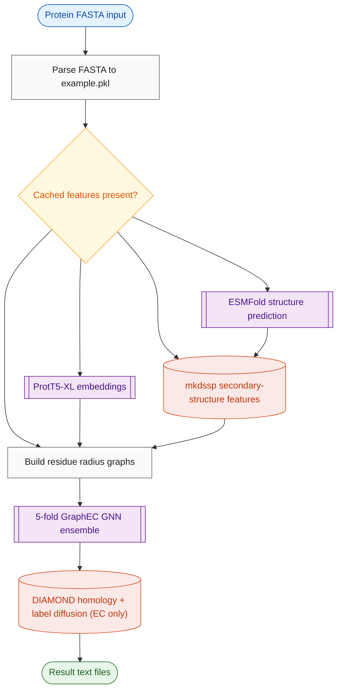

# Repository Analysis

| | |
|---|---|
| Repository | https://github.com/biomed-AI/GraphEC |
| Run ID | `GraphEC/run3` |
| Generated | 2026-10-12 07:16 UTC |

## Read this first

**Verified by direct file inspection — these are facts, not judgement:**

> **IMPRECISE PATH: 3 path(s) are written as a range or placeholder rather than a real filename: EC_number/model/fold0-4.ckpt, Active_sites/model/fold0-4.ckpt, Optimum_pH/model/fold0-4.ckpt. The files exist; expand the name before putting it in a command.**

**Reported by the analyst:**

> **BLOCKER: EC prediction broken for novel sequences** — main.py:73 comments out the Active_sites pre-step, but EC_number/utils.py:80 loads bundled Active_sites/results/EC_test_ver1.pkl; any ID not in it raises KeyError at EC_number/data.py:58. Uncomment main.py:73 to fix.
>
> **BLOCKER: ProtT5 path hardcoded to author's machine** — Features/features.py:39 model_path='/home/songyd/software/Prot-T5-XL-U50'; must be edited and ProtT5-XL downloaded from Zenodo before any feature extraction.
>
> **BLOCKER: Linux x86-64 only** — Bundled diamond (EC_number/tools/diamond) and mkdssp (Features/dssp-2.0.4/mkdssp) are Linux ELF binaries; no macOS/ARM support without replacing them.
>
> **WARNING: GPU index is mandatory and mishandled** — All task entrypoints call torch.cuda.set_device(args.gpu) with default None (crash if --gpu omitted); Optimum_pH ignores --gpu and uses device 3 (Optimum_pH/utils.py:47).
>
> **WARNING: Weights licence unstated** — Code is Apache-2.0 but no licence is given for the bundled trained checkpoints; commercial-use status unclear.
>
> **WARNING: No dependency file** — Versions exist only as README prose (torch 1.13.1, pyg 2.3.0, python 3.8.16, openfold 1.0.1); transformers and esm versions unpinned.
>
> **INFO: Feature caching is ID-based** — Features are skipped if Data/{Structures,ProtTrans,DSSP}/<ID>.tensor exists; re-running with changed sequences under the same ID silently uses stale features.

## Quickstart

**1. Install**
```bash
git clone https://github.com/biomed-AI/GraphEC.git && cd GraphEC
conda create -n graphec python=3.8.16 -y && conda activate graphec
pip install torch==1.13.1+cu117 --extra-index-url https://download.pytorch.org/whl/cu117
pip install torch-geometric==2.3.0 transformers biopython==1.81 scipy==1.10.1 scikit-learn numpy==1.24.3
pip install fair-esm openfold==1.0.1  # per official ESMFold tutorial
chmod -R 755 ./EC_number/tools/ ./Features/dssp-2.0.4/
```

**2. Get the weights**
```bash
GraphEC fold checkpoints are bundled in */model/ - no download needed
Download ProtT5-XL-UniRef50 from https://zenodo.org/record/4644188 and edit model_path at Features/features.py:39 to point at it
ESMFold v1 weights auto-download on first run of Features/esmfold/esmfold.py
```

**3. Run it**
```bash
bash run.sh EC_number ./Data/fasta/EC_number.fasta 0
```

Example input: `Data/fasta/EC_number.fasta (10 UniProt sequences; features pre-cached in Data/)`

Expected result: EC_number/results/example_top5.txt regenerated; E0VIU9 top prediction EC 2.3.2.31 with score ~0.999

Roughly minutes on GPU for the bundled example (features cached); much longer if features must be recomputed.

**Watch out for:**
- Must pass a GPU index (e.g. 0); omitting it crashes torch.cuda.set_device
- EC task on sequences NOT in Active_sites/results/EC_test_ver1.pkl crashes (KeyError) - uncomment main.py:73 and run Active_sites first
- ProtT5 path hardcoded to author's machine - edit Features/features.py:39
- Linux x86-64 only (bundled diamond/mkdssp binaries)
- Optimum_pH task hardcodes CUDA device 3 regardless of --gpu

## Metadata
| | |
|---|---|
| **Model** | GraphEC |
| **Status** | unknown (last commit 1.2 years ago) |
| **Owner** | biomed-AI (Yidong Song, Sun Yat-sen University) |
| **Category** | protein function prediction |
| **Purpose** | Predict enzyme EC numbers, active sites and optimum pH from protein sequence using geometric graph learning on ESMFold structures. |
| **Details** | GraphEC builds residue graphs from ESMFold-predicted structures (radius graph on CA atoms), augments nodes with ProtT5-XL embeddings and DSSP features, and ensembles 5 graph-transformer folds. EC prediction adds a label-diffusion step over a DIAMOND homology network against the training set. Three sub-models: GraphEC (EC), GraphEC-AS (active sites), GraphEC-pH (optimum pH). |
| **Model size** | GNN checkpoints: EC 5x92.6 MB, AS 5x6.1 MB, pH 5x6.8 MB (~565 MB total); upstream ProtT5-XL ~3B params, ESMFold v1 |
| **Peak memory** | 24.0 GB (source: estimate, not measured: ProtT5-XL fp32 ~11 GB weights + ESMFold v1 ~2.5 GB run sequentially in feature extraction (unconditional .cuda() at Features/features.py:47 and esmfold.py:144); GNN ensembles are small (~0.5 GB). 16 GB likely sufficient with --chunk-size 128; 24 GB comfortable.) |
| **Compute** | GPU required, >= 16.0 GB VRAM |
| **Input** | protein_fasta, task (string enum) |
| **Output** | example_top5.txt (text), example_all.txt (text), active_site_<ID>.txt (text), optimum_pH_<ID>.txt (text), structure_pdbs |
| **Publication** | Citation listed as 'preparing' in README |
| **Paper / preprint** | - |
| **GitHub** | <https://github.com/biomed-AI/GraphEC>, <https://github.com/facebookresearch/esm>, <https://github.com/agemagician/ProtTrans>, <https://github.com/YidongSong/GraphEC> |
| **HuggingFace** | - |
| **Colab / demo** | - |
| **Code licence** | Apache-2.0 |
| **Weights licence** | unstated |
| **Commercial use** | unclear |
| **Last commit** | 2025-08-13 1413229 Update data.py |

## What it can do
| Task | Entrypoint | Inputs | Outputs | Supported | Notes |
|---|---|---|---|---|---|
| EC number prediction | `main.py --task EC_number -> EC_number/utils.py::predict` | multi-entry protein FASTA | EC_number/results/example_top5.txt (top-5 EC + scores), example_all.txt (5106-label score vector) | partial | Works for the bundled example; novel sequences crash because the active-site pre-step is commented out (main.py:73) and EC_test_ver1.pkl only covers bundled IDs. Label diffusion needs bundled diamond binary + EC_train.fa/pkl (present). |
| active site prediction (GraphEC-AS) | `main.py --task ActiveSite -> Active_sites/utils.py::predict` | multi-entry protein FASTA | Active_sites/results/<ID>.txt per-residue scores + test_pred_dict.pkl | yes | 5-fold ensemble, per-residue sigmoid scores. |
| optimum pH prediction (GraphEC-pH) | `main.py --task Optimum_pH -> Optimum_pH/utils.py::predict` | multi-entry protein FASTA | Optimum_pH/results/<ID>.txt with class acidic/neutral/alkaline | partial | Hardcodes cuda device 3 (Optimum_pH/utils.py:47); crashes on single-GPU machines. |
| protein structure prediction (ESMFold wrapper) | `Features/esmfold/esmfold.py` | FASTA | PDB files + coordinate tensors in Data/Structures/ | needs_extra_assets | Auto-downloads ESMFold v1 weights; requires esm/openfold install. |

## Process flow


## Repository structure
```
./  (4 files)
  Active_sites/  (4 files)
    Active_sites/data/  (1 files)
    Active_sites/model/  (5 files)
    Active_sites/results/  (12 files)
  Data/  (1 files)
    Data/DSSP/  (30 files)
    Data/ProtTrans/  (32 files)
    Data/Structures/  (60 files)
    Data/fasta/  (3 files)
  EC_number/  (5 files)
    EC_number/data/  (5 files)
    EC_number/model/  (5 files)
    EC_number/results/  (2 files)
    EC_number/tools/  (1 files)
  Features/  (1 files)
    Features/dssp-2.0.4/  (1 files)
    Features/esmfold/  (3 files)
  Optimum_pH/  (4 files)
    Optimum_pH/data/  (1 files)
    Optimum_pH/model/  (5 files)
    Optimum_pH/results/  (10 files)
```

## Inputs
| Name | Format | Required | Description | Constraints | Example |
|---|---|---|---|---|---|
| `protein_fasta` | fasta | yes | multi-entry FASTA; header ID becomes the key for all cached feature tensors and output filenames | standard 20 amino acids; U/Z/O/B mapped to X for ProtT5; IDs must be filesystem-safe; sequence on the single line following the header | `>E0VIU9\nMKKFFDSR...` |
| `task` | string enum | yes | one of EC_number, ActiveSite, Optimum_pH (part of invocation, selects pipeline) | - | `EC_number` |

## Outputs
| Name | Format | Description | Constraints | Example |
|---|---|---|---|---|
| `example_top5.txt` | text | EC task: per-sequence top-5 EC numbers with sigmoid scores after label diffusion (lambda=0.1) | - | `E0VIU9 -> EC: 2.3.2.31 \| 0.999` |
| `example_all.txt` | text | EC task: full 5106-label score vector per sequence | large (~400 KB for 10 sequences) | - |
| `active_site_<ID>.txt` | text | Active_sites task: per-residue table Num/AA/Score (sigmoid probability of being an active site) | - | `Active_sites/results/1BVZA.txt` |
| `optimum_pH_<ID>.txt` | text | pH task: single class label per sequence | - | `E2GDF4 acidic` |
| `structure_pdbs` | pdb | intermediate ESMFold-predicted structures in Data/Structures/ (cached, reused across tasks) | - | - |

## Inference entrypoint
| | |
|---|---|
| File | `main.py` |
| Function/class | `__main__ (dispatches to EC_number/utils.py::predict etc.)` |
| How to call | bash run.sh EC_number ./Data/fasta/EC_number.fasta 0 |
| Input format | multi-entry FASTA of protein sequences |
| Output format | text files: EC_number/results/example_top5.txt (top-5 EC + score per sequence), example_all.txt (full 5106-label scores); Active_sites/results/<ID>.txt (per-residue scores); Optimum_pH/results/<ID>.txt (class label) |

## Files
| Path | Kind | Purpose | How to run |
|---|---|---|---|
| `run.sh` | shell | wrapper for main.py | `bash run.sh EC_number ./Data/fasta/EC_number.fasta 0` |
| `main.py` | cli | orchestrator: fasta parsing, feature extraction, task dispatch | `python main.py --task EC_number --fasta ./Data/fasta/EC_number.fasta --gpu 0` |
| `EC_number/main.py` | cli | EC prediction (called by main.py) | `python ./EC_number/main.py --fasta X.fa --gpu 0` |
| `Active_sites/main.py` | cli | active-site prediction | `python ./Active_sites/main.py --gpu 0` |
| `Optimum_pH/main.py` | cli | optimum pH prediction | `python ./Optimum_pH/main.py --gpu 0` |
| `Features/esmfold/esmfold.py` | cli | ESMFold structure prediction | `python ./Features/esmfold/esmfold.py -i in.fasta -o ./Data/Structures/ --chunk-s` |
| `Features/features.py` | module | feature extraction: ProtTrans embeddings, ESMFold structures, DSSP | - |
| `EC_number/utils.py` | module | EC number inference: 5-fold ensemble + label diffusion, writes results | - |
| `EC_number/label_diffusion.py` | module | homology graph via DIAMOND + label diffusion | - |
| `EC_number/data.py` | module | graph dataset construction and geometric features | - |
| `Active_sites/utils.py` | module | active-site inference (per-residue scores) | - |
| `Optimum_pH/utils.py` | module | optimum pH inference (3-class) | - |

## Assets
| Path | Kind | Size (MB) | Availability | Description |
|---|---|---|---|---|
| `EC_number/model/fold0-4.ckpt` | weights | 463.0 | in repo | 5-fold EC number model checkpoints |
| `Active_sites/model/fold0-4.ckpt` | weights | 31.0 | in repo | 5-fold active-site checkpoints |
| `Optimum_pH/model/fold0-4.ckpt` | weights | 34.0 | in repo | 5-fold pH checkpoints |
| `EC_number/data/EC_train.fa` | data | 29.0 | in repo | training sequences for DIAMOND label diffusion |
| `EC_number/data/EC_train.pkl` | data | 30.0 | in repo | training labels for diffusion seeds |
| `EC_number/data/EC_idx.pkl` | config | - | in repo | EC number <-> index mapping (5106 labels) |
| `EC_number/tools/diamond` | other | 40.0 | in repo | bundled Linux x86-64 DIAMOND binary |
| `Features/dssp-2.0.4/mkdssp` | other | 0.9 | in repo | bundled Linux x86-64 DSSP binary |
| `Data/fasta/EC_number.fasta` | example | - | in repo | 10-sequence example input with pre-cached features |
| `Data/fasta/Active_sites.fasta` | example | - | in repo | example input for GraphEC-AS |
| `Data/fasta/optimum_pH.fasta` | example | - | in repo | example input for GraphEC-pH |
| `EC_number/results/example_top5.txt` | example | - | in repo | committed expected output (regression reference) |
| `ProtT5-XL-UniRef50` | weights | 11000.0 | download | ProtTrans encoder, manual download from Zenodo |
| `ESMFold v1 weights` | weights | 2500.0 | download | auto-downloaded by esm.pretrained.esmfold_v1() |

## Compute requirements
| | |
|---|---|
| GPU required | True |
| Runs on CPU | False |
| Min GPU memory | 16.0 GB |
| Peak memory | 24.0 GB (source: estimate, not measured: ProtT5-XL fp32 ~11 GB weights + ESMFold v1 ~2.5 GB run sequentially in feature extraction (unconditional .cuda() at Features/features.py:47 and esmfold.py:144); GNN ensembles are small (~0.5 GB). 16 GB likely sufficient with --chunk-size 128; 24 GB comfortable.) |
| Min RAM | 32.0 GB |
| Disk (repo + weights) | 2.0 GB |
| Downloaded at runtime | 14.0 GB (additional) |
| Platform | Linux x86-64: bundled ELF binaries Features/dssp-2.0.4/mkdssp and EC_number/tools/diamond |
| Prebuilt binaries | `Features/dssp-2.0.4/mkdssp` ELF (Linux), `EC_number/tools/diamond` ELF (Linux) - these fix the OS and architecture |
| Typical runtime | minutes per protein for ESMFold+ProtT5 feature extraction on a modern GPU; GNN inference seconds; DIAMOND label diffusion against 29 MB training fasta adds minutes |
| Notes | Features are cached as tensors under Data/; re-runs on the same IDs skip extraction. EC_number/utils.py sets num_workers=64 dataloader workers. |

## Weights
- Source: bundled in repo (5-fold checkpoints per task); ESMFold and ProtT5-XL downloaded separately
- Location/ID: `EC_number/model/fold0-4.ckpt, Active_sites/model/fold0-4.ckpt, Optimum_pH/model/fold0-4.ckpt`
- Size: 0.56 GB
- Download: GraphEC folds are in the repo. ESMFold v1 weights auto-download via esm.pretrained.esmfold_v1(). ProtT5-XL-UniRef50 must be downloaded manually from https://zenodo.org/record/4644188 and the hardcoded path in Features/features.py:39 edited.

## Licensing
| | |
|---|---|
| Code | Apache-2.0 (LICENSE) |
| Weights | unstated (no weights licence file; README silent) |
| Commercial use | unclear |
| Attribution required | False |
| Notes | Code is Apache-2.0. Trained checkpoint terms are not stated anywhere; ESMFold and ProtT5 upstream models carry their own licences (ESMFold CC-BY-4.0 weights; ProtT5 academic). |

## Tests
**No test suite.** The repo ships a reference input/output pair (`Data/fasta/EC_number.fasta` -> `EC_number/results/example_top5.txt`), which can serve as a regression check instead of a test run. E0VIU9 top EC should be 2.3.2.31 at 0.999; Q8IWZ4 top EC 2.3.2.27 at 1.0. For pH: Optimum_pH/results/E2GDF4.txt should say 'acidic'.

## Known bugs
| Severity | What | Fires when | Evidence | |
|---|---|---|---|---|
| wrong_output | **Stale-feature reuse by ID** feature extraction skipped purely on file existence of <ID>.tensor | re-running with a different sequence under a previously used ID | `main.py:40-45` | verified |
| crash | **EC prediction KeyError on novel sequences** Active-site pre-step commented out (main.py:73); EC pipeline loads bundled EC_test_ver1.pkl and indexes it by sequence ID | EC_number task with any sequence ID not present in Active_sites/results/EC_test_ver1.pkl | `main.py:73, EC_number/utils.py:80, EC_number/data.py:58` | verified |
| crash | **Hardcoded ProtT5 path** model_path = '/home/songyd/software/Prot-T5-XL-U50' | any run where ProtTrans features are not already cached | `Features/features.py:39` | verified |
| crash | **Unconditional .cuda() in ProtTrans extraction** model = model.cuda() regardless of device; device string 'cuda:' + gpu also breaks when gpu is None | CPU-only machine, or --gpu omitted | `Features/features.py:45-47` | verified |
| crash | **torch.cuda.set_device(None) when --gpu omitted** argparse default for --gpu is None in all three task entrypoints | invoking any task without --gpu | `EC_number/main.py:13, Active_sites/main.py:15, Optimum_pH/main.py:13` | verified |
| crash | **Optimum_pH ignores --gpu, hardcodes device 3** device = 'cuda:'+str(args.device); args.device defaults to 3 and is never set from --gpu | Optimum_pH task on a machine with fewer than 4 GPUs | `Optimum_pH/utils.py:47, Optimum_pH/main.py:8` | verified |
| crash | **Unchecked os.system calls throughout** diamond, mkdssp, esmfold subprocess return codes never checked; failures surface later as missing-file errors | any subprocess failure (permissions, missing binary) | `EC_number/label_diffusion.py:59-67, Features/features.py:118,197` | verified |
| dormant | **Wrong relative path for ProtTrans normalization constants** '../Data/ProtTrans/Max_protTrans.npy' (also case-mismatched vs Max_ProtTrans.npy) would fail from repo root | dormant - only fires if the normalization line (features.py:82) is uncommented | `Features/features.py:37-38` | verified |

## Performance bottlenecks
| What | Evidence |
|---|---|
| **ProtTrans embedding batch_size=1** one sequence per ProtT5 forward pass | `Features/features.py:52` |
| **5 models loaded and run per batch** full 5-fold ensemble forward for every batch; EC folds are 92 MB each | `EC_number/utils.py:91-116` |
| **Label diffusion shells out to DIAMOND repeatedly and inverts a sparse matrix per lambda** makedb + blastp against 29 MB training fasta, then scipy inv() for each of 4 lambda values | `EC_number/label_diffusion.py:123-196` |
| **num_workers=64 dataloader workers** hardcoded in EC_number config; will oversubscribe small instances | `EC_number/utils.py:31` |
| **Features re-parsed from fasta per stage** fasta parsed independently in main.py, features.py (x3) and label_diffusion.py | `main.py:12, Features/features.py:28,120,192` |

## Inference call path
| Defined at | Name | Purpose | Called by | Calls |
|---|---|---|---|---|
| `main.py:12` | `process_fasta` | parse fasta into {name: seq} dict, pickle to ./Data/example.pkl | __main__ (main.py:69) | pickle.dump |
| `main.py:27` | `extract_features` | run ESMFold/ProtTrans/DSSP extraction only for IDs missing cached tensors | __main__ (main.py:70) | features.get_esmfold, features.get_prottrans, features.get_dssp |
| `Features/features.py:19` | `get_prottrans` | ProtT5-XL per-residue embeddings (1024-d), saved as .tensor per ID | extract_features (main.py:55) | T5EncoderModel.from_pretrained (hardcoded path) |
| `Features/features.py:117` | `get_esmfold` | run ESMFold subprocess, parse PDB to N/CA/C/O/R coordinates tensor | extract_features (main.py:51) | os.system esmfold.py, get_pdb_xyz |
| `Features/features.py:188` | `get_dssp` | run bundled mkdssp on each PDB, build 9-d ASA+secondary-structure features | extract_features (main.py:60) | os.system mkdssp, process_dssp, match_dssp |
| `EC_number/utils.py:64` | `predict` | load 5 fold checkpoints, ensemble EC predictions, run label diffusion, write example_all.txt / example_top5.txt | EC_number/main.py:14 | ProteinGraphDataset, LabelDiffusion, padding_ver1 |
| `EC_number/label_diffusion.py:114` | `LabelDiffusion` | DIAMOND alignment of queries vs training set, homology graph, sparse label diffusion | predict (EC_number/utils.py:124) | homology_matrix, compute_L, os.system diamond |
| `EC_number/data.py:32` | `ProteinGraphDataset._featurize_graph` | load cached structure/ProtTrans/DSSP tensors, build radius graph (r=10) and node features | DataLoader via __getitem__ | torch_geometric.nn.radius_graph |
| `Active_sites/utils.py:42` | `predict` | 5-fold ensemble per-residue active-site scores, writes per-ID txt + test_pred_dict.pkl | Active_sites/main.py:16 | ProteinGraphDataset (Active_sites/data.py) |
| `Optimum_pH/utils.py:43` | `predict` | 5-fold ensemble 3-class (acidic/neutral/alkaline) pH prediction, writes per-ID txt | Optimum_pH/main.py:15 | ProteinGraphDataset (Optimum_pH/data.py) |

## Environment and versions

**No dependency file in the repo.** Every version below is a claim in prose, not a lock.
| Package | Version | Stated in | Source |
|---|---|---|---|
| `python` | 3.8.16 | README prose | `README.md:7` |
| `numpy` | 1.24.3 | README prose | `README.md:7` |
| `torch` | 1.13.1 | README prose | `README.md:7` |
| `torch-geometric` | 2.3.0 | README prose | `README.md:7` |
| `biopython` | 1.81 | README prose | `README.md:7` |
| `openfold` | 1.0.1 | README prose | `README.md:7` |
| `scipy` | 1.10.1 | README prose | `README.md:7` |
| `debugpy` | 1.6.7 | README prose | `README.md:7` |
| `decorator` | 5.1.1 | README prose | `README.md:7` |
| `filelock` | 3.12.1 | README prose | `README.md:7` |
| `idna` | 3.4 | README prose | `README.md:7` |
| `ipython` | 8.12.0 | README prose | `README.md:7` |
| `six` | 1.16.0 | README prose | `README.md:7` |
| `transformers` | _unpinned_ | README prose | `Features/features.py:2` |
| `fair-esm` | _unpinned_ | README prose | `Features/esmfold/esmfold.py:9` |
| `scikit-learn` | _unpinned_ | README prose | `EC_number/utils.py:12` |
| `tqdm` | _unpinned_ | README prose | `main.py:5` |
| `pyg` | 2.3.0 | README prose | `README.md:7` |
| `pytorch` | 1.13.1 | README prose | `README.md:7` |
| `gmp` | 6.2.1 | README prose | `README.md:7` |

4 dependency/-ies are imported but pinned nowhere - they will resolve to whatever is current at build time.

## Dependencies
- Notable: torch 1.13.1, torch-geometric 2.3.0, openfold 1.0.1, biopython 1.81, transformers, esm, diamond (bundled binary), mkdssp (bundled binary)
- Python: 3.8.16 (README prose, unconfirmed); frameworks: PyTorch, PyTorch Geometric, transformers (ProtT5), ESMFold (esm), scikit-learn, scipy, biopython

