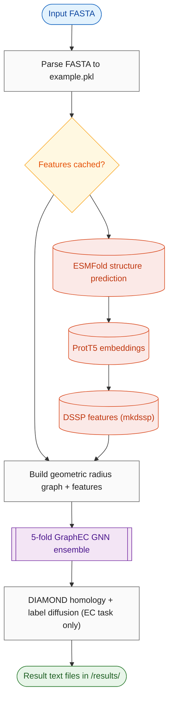

# Repository Analysis

| | |
|---|---|
| Repository | https://github.com/biomed-AI/GraphEC |
| Run ID | `GraphEC/run2` |
| Generated | 2026-10-10 05:30 UTC |

## Read this first

**Verified by direct file inspection — these are facts, not judgement:**

> **ANALYSIS INCOMPLETE: GPU required but no VRAM estimate - the instance cannot be sized**

**Reported by the analyst:**

> **BLOCKER: Hardcoded ProtT5 weights path** — Features/features.py line 39: model_path = '/home/songyd/software/Prot-T5-XL-U50'. Feature extraction for any non-cached sequence fails until edited and weights downloaded from Zenodo.
>
> **BLOCKER: EC prediction on new sequences is broken out of the box** — EC_number/utils.py loads precomputed active sites from Active_sites/results/EC_test_ver1.pkl (only the 10 bundled example IDs); the Active_sites pre-run in main.py line 73 is commented out, so novel IDs will KeyError.
>
> **BLOCKER: GPU effectively required** — All task main.py files call torch.cuda.set_device(args.gpu) with default None (crashes); features.py calls model.cuda() unconditionally. No CPU path.
>
> **WARNING: Weights licence unstated** — Code is Apache-2.0 but the bundled checkpoints have no stated licence; commercial use of the weights is unclear. No published paper ('Citation: preparing').
>
> **WARNING: No dependency file; old pinned stack** — Python 3.8.16, torch 1.13.1, PyG 2.3.0, openfold 1.0.1 exist only as README prose; environment must be assembled by hand.
>
> **WARNING: Shell-outs and destructive rm in pipeline** — label_diffusion.py and features.py use os.system for DIAMOND/mkdssp and 'rm' intermediates in the CWD; bundled binaries are Linux x86 and may need chmod 755.
>
> **INFO: Project appears unmaintained** — Last commit 2025-08-13 (~14 months ago at analysis); citation never published; no tests or CI.

## Quickstart

**1. Install**
```bash
git clone https://github.com/biomed-AI/GraphEC.git && cd GraphEC
conda create -n graphec python=3.8.16 -y && conda activate graphec
pip install torch==1.13.1+cu117 --extra-index-url https://download.pytorch.org/whl/cu117
pip install torch_geometric==2.3.0 torch_scatter -f https://data.pyg.org/whl/torch-1.13.1+cu117.html
pip install transformers biopython==1.81 scipy==1.10.1 scikit-learn tqdm numpy==1.24.3
pip install fair-esm openfold==1.0.1  # needed only if features are not cached
chmod -R 755 ./EC_number/tools/ ./Features/dssp-2.0.4/
```

**2. Get the weights**
```bash
GraphEC checkpoints are bundled (EC_number/model/, Active_sites/model/, Optimum_pH/model/) - no download needed
For new sequences: download ProtT5-XL-UniRef50 from https://zenodo.org/record/4644188 and edit model_path in Features/features.py line 39; ESMFold weights auto-download
```

**3. Run it**
```bash
bash run.sh EC_number ./Data/fasta/EC_number.fasta 0
```

Example input: `./Data/fasta/EC_number.fasta (10 example proteins; features pre-cached in ./Data/)`

Expected result: ./EC_number/results/example_top5.txt with lines like 'EC: 2.7.11.1 | 0.987' per protein, plus example_all.txt with full 5106-dim score vectors

Roughly minutes on GPU for the cached examples (label diffusion adds DIAMOND alignment time).

**Watch out for:**
- Must pass a valid GPU index; omitting --gpu crashes (torch.cuda.set_device(None))
- Works out of the box only for the 10 bundled example IDs; new sequences need ProtT5 path fix, ESMFold install, and a manual Active_sites pre-run to regenerate EC_test_ver1.pkl
- chmod -R 755 ./EC_number/tools/ may be needed for the bundled DIAMOND binary
- No requirements.txt; versions only in README prose

## Metadata
| | |
|---|---|
| **Model** | GraphEC |
| **Status** | unknown (last commit 1.2 years ago) |
| **Owner** | biomed-AI (Yidong Song, Sun Yat-sen University) |
| **Category** | protein function prediction |
| **Purpose** | Predict enzyme EC numbers, active sites and optimum pH from protein sequence using geometric graph learning on ESMFold structures. |
| **Details** | GraphEC identifies enzyme active sites, then trains a geometric graph neural network (TransformerConv-based, 5-fold ensemble) on ESMFold-predicted structures augmented with ProtT5-XL sequence embeddings and DSSP features. A label diffusion algorithm over a DIAMOND homology network against the training set improves EC prediction. A third head predicts optimum pH (acidic/neutral/alkaline). |
| **Model size** | EC_number: 5 x 92.6 MB ckpts; Active_sites: 5 x 6.1 MB; Optimum_pH: 5 x 6.8 MB (~565 MB total, bundled) |
| **Peak memory** | - |
| **Compute** | GPU required |
| **Input** | fasta, int |
| **Output** | text, text, text, text |
| **Publication** | None stated; README says 'Citation: preparing' |
| **Paper / preprint** | - |
| **GitHub** | <https://github.com/biomed-AI/GraphEC>, <https://github.com/facebookresearch/esm>, <https://github.com/agemagician/ProtTrans>, <https://github.com/YidongSong/GraphEC> |
| **HuggingFace** | - |
| **Colab / demo** | - |
| **Code licence** | Apache-2.0 |
| **Weights licence** | unstated |
| **Commercial use** | unclear |
| **Last commit** | 2025-08-13 1413229 Update data.py |

## What it can do
| Task | Entrypoint | Inputs | Outputs | Supported | Notes |
|---|---|---|---|---|---|
| EC number prediction | `run.sh EC_number -> EC_number/main.py -> EC_number/utils.py:predict` | FASTA + cached features + precomputed active sites | EC_number/results/example_top5.txt, example_all.txt | partial | Out of the box only for bundled example IDs; new sequences need active-site pre-step (commented out) and feature extraction |
| active site prediction (GraphEC-AS) | `run.sh ActiveSite -> Active_sites/main.py` | FASTA | Active_sites/results/{ID}.txt per-residue scores + test_pred_dict.pkl | yes |  |
| optimum pH prediction (GraphEC-pH) | `run.sh Optimum_pH -> Optimum_pH/main.py` | FASTA | Optimum_pH/results/{ID}.txt (acidic/neutral/alkaline) | yes |  |
| feature extraction (ESMFold structure, ProtT5 embedding, DSSP) | `Features/features.py via main.py:extract_features` | FASTA | Data/Structures|ProtTrans|DSSP/{ID}.tensor | needs_extra_assets | Requires ProtT5 weights at a hardcoded path and ESMFold install |

## Process flow


## Repository structure
```
./  (4 files)
  Active_sites/  (4 files)
    Active_sites/data/  (1 files)
    Active_sites/model/  (5 files)
    Active_sites/results/  (12 files)
  Data/  (1 files)
    Data/DSSP/  (30 files)
    Data/ProtTrans/  (32 files)
    Data/Structures/  (60 files)
    Data/fasta/  (3 files)
  EC_number/  (5 files)
    EC_number/data/  (5 files)
    EC_number/model/  (5 files)
    EC_number/results/  (2 files)
    EC_number/tools/  (1 files)
  Features/  (1 files)
    Features/dssp-2.0.4/  (1 files)
    Features/esmfold/  (3 files)
  Optimum_pH/  (4 files)
    Optimum_pH/data/  (1 files)
    Optimum_pH/model/  (5 files)
    Optimum_pH/results/  (10 files)
```

## Inputs
| Name | Format | Required | Description | Constraints | Example |
|---|---|---|---|---|---|
| `fasta` | fasta | yes | protein sequences, >ID header then single-line sequence | single chain per record; U/Z/O/B mapped to X; feature cache keyed by ID | `>E0VIU9\nMSILEWFWNILCGMAQYLTFSKNLTNDNLVNIYVKSNVGGTISVNLDPKSDIKNVKELVAPKLGLEPDDVK` |
| `gpu` | int | yes | GPU device index; effectively required | - | `0` |

## Outputs
| Name | Format | Description | Constraints | Example |
|---|---|---|---|---|
| `example_top5.txt` | text | top-5 EC numbers with scores per protein | - | `EC: 2.7.11.1 \| 0.987` |
| `example_all.txt` | text | full 5106-dim sigmoid score vector per protein (after label diffusion, lambda=0.1) | - | - |
| `Active_sites/results/{ID}.txt` | text | per-residue Num/AA/Score (sigmoid 0-1) table | - | - |
| `Optimum_pH/results/{ID}.txt` | text | predicted class: acidic, neutral or alkaline | - | - |

## Inference entrypoint
| | |
|---|---|
| File | `main.py` |
| Function/class | `main (dispatches to EC_number/utils.py:predict, Active_sites/utils.py:predict, Optimum_pH/utils.py:predict)` |
| How to call | bash run.sh EC_number ./Data/fasta/EC_number.fasta 0 |
| Input format | FASTA file (>ID newline sequence); features cached per ID under ./Data/ |
| Output format | text files under <task>/results/: top-5 EC list + full score vector (EC_number), per-residue scores (Active_sites), class label (Optimum_pH) |

## Files
| Path | Kind | Purpose | How to run |
|---|---|---|---|
| `run.sh` | shell | wrapper for main.py | `bash run.sh <EC_number\|ActiveSite\|Optimum_pH> <fasta> <gpu_num>` |
| `main.py` | cli | fasta parsing, feature extraction, task dispatch | `python main.py --task EC_number --fasta ./Data/fasta/EC_number.fasta --gpu 0` |
| `EC_number/main.py` | cli | EC prediction entry | `python ./EC_number/main.py --fasta X --gpu 0` |
| `Active_sites/main.py` | cli | active-site prediction entry | `python ./Active_sites/main.py --gpu 0` |
| `Optimum_pH/main.py` | cli | optimum pH prediction entry | `python ./Optimum_pH/main.py --gpu 0` |
| `Features/esmfold/esmfold.py` | cli | run ESMFold to predict PDB structures | `python ./Features/esmfold/esmfold.py -i in.fasta -o out_dir --chunk-size 128` |
| `Features/features.py` | module | feature extraction: ProtT5 embeddings, ESMFold coords, DSSP | - |
| `EC_number/utils.py` | module | EC inference: 5-fold ensemble predict + result writing | - |
| `EC_number/label_diffusion.py` | module | homology network (DIAMOND) + label diffusion | - |
| `EC_number/model.py` | module | GraphEC GNN (TransformerConv layers) | - |
| `Active_sites/utils.py` | module | active-site per-residue inference | - |
| `Optimum_pH/utils.py` | module | optimum pH inference | - |

## Assets
| Path | Kind | Size (MB) | Availability | Description |
|---|---|---|---|---|
| `EC_number/model/` | weights | 463.0 | in repo | 5-fold GraphEC EC checkpoints |
| `Active_sites/model/` | weights | 30.0 | in repo | 5-fold GraphEC-AS checkpoints |
| `Optimum_pH/model/` | weights | 34.0 | in repo | 5-fold GraphEC-pH checkpoints |
| `Data/fasta/EC_number.fasta` | example | - | in repo | 10 example enzyme sequences |
| `Data/` | data | 60.0 | in repo | pre-cached Structures/ProtTrans/DSSP feature tensors for example proteins |
| `EC_number/data/EC_train.fa` | data | 29.0 | in repo | training sequences for label-diffusion homology search |
| `EC_number/data/EC_train.pkl` | data | 30.0 | in repo | training labels for label diffusion |
| `EC_number/tools/diamond` | other | 40.0 | in repo | bundled DIAMOND alignment binary (Linux) |
| `Features/dssp-2.0.4/mkdssp` | other | - | in repo | bundled DSSP binary |
| `ProtT5-XL-UniRef50` | weights | - | download | feature extractor; download from Zenodo, path hardcoded in Features/features.py |
| `ESMFold weights` | weights | - | download | auto-downloaded by esm package on first run |

## Compute requirements
| | |
|---|---|
| GPU required | True |
| Runs on CPU | False |
| Min GPU memory | - GB |
| Peak memory | - |
| Min RAM | - GB |
| Disk | 1.5 GB |
| Typical runtime | not stated; inference on the 10 cached example proteins is minutes; ESMFold folding dominates for new sequences |
| Notes | torch.cuda.set_device(args.gpu) called unconditionally in all task main.py; features.py calls model.cuda() unconditionally. No CPU fallback wired. |

## Weights
- Source: bundled in repo (5-fold checkpoints per task); feature extractors external
- Location/ID: `EC_number/model/fold0-4.ckpt, Active_sites/model/fold0-4.ckpt, Optimum_pH/model/fold0-4.ckpt`
- Size: 0.56 GB
- Download: GraphEC weights are in the repo. ProtT5-XL-UniRef50 must be downloaded (README points to https://zenodo.org/record/4644188) and the hardcoded path in Features/features.py line 39 edited; ESMFold weights download automatically via the esm package.

## Licensing
| | |
|---|---|
| Code | Apache-2.0 (LICENSE) |
| Weights | unstated (no weights licence file or README terms found) |
| Commercial use | unclear |
| Attribution required | False |
| Notes | Code is Apache-2.0 (commercial OK). Bundled GraphEC checkpoints carry no stated licence. External dependencies (ProtT5, ESMFold weights) have their own terms. |

## Functions and classes
| File | Name | Signature | Purpose |
|---|---|---|---|
| `main.py` | `process_fasta` | `process_fasta(fasta_path)` | parse fasta to ./Data/example.pkl |
| `main.py` | `extract_features` | `extract_features(name_seq, fasta, gpu)` | run ESMFold/ProtTrans/DSSP for missing cached features |
| `EC_number/utils.py` | `predict` | `predict(args, seed)` | 5-fold ensemble EC prediction + label diffusion + write results |
| `EC_number/label_diffusion.py` | `LabelDiffusion` | `LabelDiffusion(initial_pred, lamda, args, identity_cutoff=0.1)` | diffuse predictions over DIAMOND homology network |
| `Active_sites/utils.py` | `predict` | `predict(model_class, args)` | per-residue active-site scores |
| `Optimum_pH/utils.py` | `predict` | `predict(model_class, args)` | acidic/neutral/alkaline classification |
| `Features/features.py` | `get_prottrans` | `get_prottrans(fasta_file, output_path, gpu)` | ProtT5-XL per-residue embeddings (hardcoded model path) |

## Dependencies
- Files: 
- Notable: torch==1.13.1, torch_geometric==2.3.0, torch_scatter, transformers, esm (ESMFold), openfold==1.0.1, biopython==1.81, dssp (bundled mkdssp binary), diamond (bundled binary)
- Python: 3.8.16 (per README); frameworks: PyTorch 1.13.1, PyTorch Geometric 2.3.0, transformers (ProtT5), ESMFold/esm, scikit-learn, scipy, biopython

